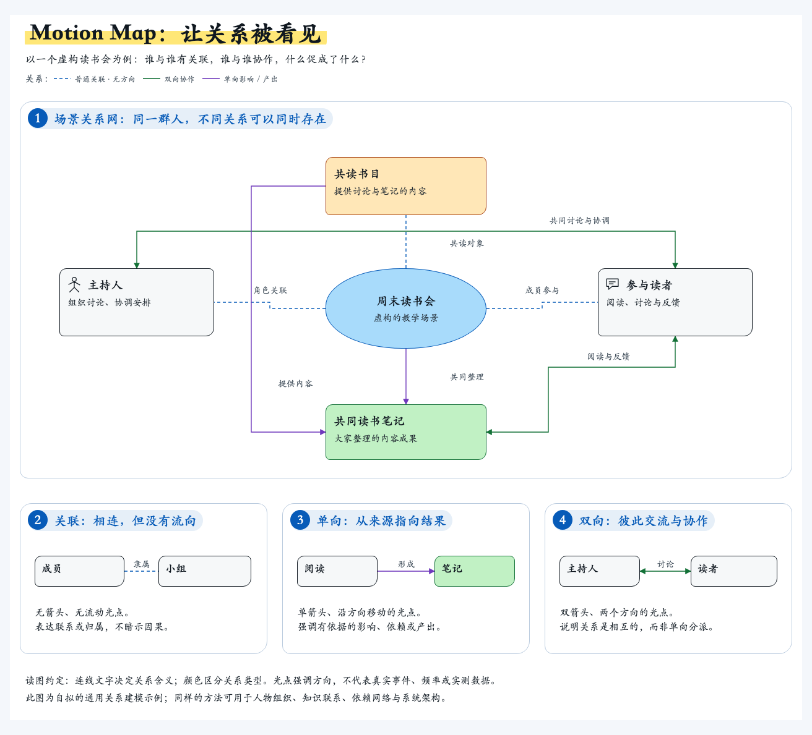

# Motion Map · 动态关系图

月政自己的可编辑动态图 skill。把人物与组织、知识概念、依赖、协作、因果与系统结构整理成关系图，再用恰当的动画强调方向。

由 [bassnova42/arch-diagram-skill](https://github.com/bassnova42/arch-diagram-skill) fork 演进，保留 MIT 许可证与原作者署名；独立名称、安装入口、关系建模工作流、主题及讲解板由此 fork 维护。



[交互示例](docs/reading-club.html) · [12 秒视频](docs/reading-club.mp4) · [可编辑规格](skills/motion-map/examples/reading-club.json)

## 把方向、时序和间接依赖说清楚

- **时序图**：以参与者和有序消息建模，区分调用、异步发送、响应与自调用。响应必须通过 `replyTo` 对应到先前请求，发送方/接收方要反向匹配；线性模型中同步调用未返回，发送方不能继续发新消息。动画按消息顺序播放，Mermaid 导出为 `sequenceDiagram`。
- **依赖图**：显式声明“依赖方 → 被依赖方”。间接 A→C 必须有可校验的 A→B→C 直接依赖路径；关联、协作和推测边不能充当证据。结构依赖保持静态。
- **关系图**：单向、双向和无方向各有不同含义。请求和响应不能合并成一条无先后的双向关联；跨图比较时应先读箭头约定。

[下单时序预览](docs/order-sequence.png) · [动态时序 HTML](docs/order-sequence.html) · [16 秒完整循环视频](docs/order-sequence.mp4) · [原生 Mermaid](docs/order-sequence.mmd)

[直接/间接依赖预览](docs/dependency-paths.png) · [交互 HTML](docs/dependency-paths.html) · [可编辑规格](skills/motion-map/examples/dependency-paths.json)

当前时序模式支持线性消息序列；并行/条件片段、激活条及实测时间轴尚未实现，不会把异步消息解释成已证明的并行。路径校验检查的是规格内部证据链，事实仍需来源。

## 不同关系，不同表达

| 关系 | Spec 字段 | 图与动画 |
| --- | --- | --- |
| 单向影响、依赖、产出 | `relation: "directed"` | 单箭头，光点沿方向运动；可用 `packet: false` 关闭光点 |
| 双向沟通、反馈、协作 | `relation: "bidirectional"` | 双箭头，两个方向的光点 |
| 归属、关联、共现 | `relation: "association"` | 无箭头、无运动，不暗示方向或因果 |

关系可以在 `flows[]` 中统一定义，再由边引用；单条边可以覆盖关系类型。旧规格的 `arrow` / `packet` 仍支持。Mermaid 导出保留方向语义。动画是关系的讲解辅助，不表示真实事件或流量。

## 安装

需要 Node ≥18。构建 HTML 不需要浏览器；布局检查、PNG/视频需要 Chrome、Chromium 或 Edge；视频与 GIF 需要 ffmpeg。

```bash
git clone https://github.com/yuezheng2006/motion-map-skill.git
cd motion-map-skill
node bin/cli.mjs install
```

默认安装到 Claude Code；检测到 Codex 时也安装到其 skills 目录。可用 `--claude` / `--codex` 选择，`--project` 安装到当前项目，或 `--dir ./my-skills` 安装到指定目录。不会自动删除旧的 `arch-diagram` skill。

重启 Agent 后，直接使用：

```text
$motion-map 把这些人物与组织的关系画成动态图，注明关联、协作与影响。
$motion-map 整理这篇文章的概念关系，因果结论要有依据。
$motion-map 用手绘讲解板解释这个流程，导出 12 秒视频。
$motion-map 画出当前仓库的系统架构与依赖。
```

本 fork 尚未发布 npm 包。安装依赖本仓库，避免误装上游同名包。CLI 主命令名为 `motion-map`，保留 `arch-diagram` 作为命令兼容别名；技能调用入口为 `$motion-map`。

## 构建与导出

```bash
node bin/cli.mjs build skills/motion-map/examples/reading-club.json map.html
node bin/cli.mjs check map.html preview.png
node bin/cli.mjs export map.html map.png map.mp4 map.mmd --seconds 12 --theme sketch
```

单文件 HTML 可离线打开，支持主题切换、暂停与原始尺寸查看。默认导出使用内嵌主题，也可用 `--theme paper|porcelain|blueprint|graphite|sketch` 覆盖。

## 布局与主题

关系网按内容选择中心辐射、层级、依赖网或流程；需要分块讲清概念时使用 `layout: "explainer"`，需要较强标题层级时使用 `presentation: true`。两者选一种。颜色选择与布局分开：暖纸、冷瓷、蓝图、石墨、白板五套主题可用。

每个节点都应有来源或标明是示意；每条关系都应有具体标签。普通关联不能画成因果。未知或推测关系要明确标注；没有实际运行记录就不展示伪造的实时状态。

## 示例

| 示例 | 说明 |
| --- | --- |
| [读书会](docs/reading-club.html) | 自拟关系网，展示三种关系语义 |
| [音乐伴奏提取](docs/music-separation.html) | 双域模型、重叠拼接、两轨输出；[信源](docs/music-separation.sources.md) |
| [DSH 讲解板](docs/dsh-explainer.html) | 多块概念讲解；[信源](docs/dsh-explainer.sources.md) |
| [DSH 系统图](docs/dsh-superagent.html) | 原型机制与文章方案分层；[信源](docs/dsh-superagent.sources.md) |
| [处理流程](docs/atelier.html) | 从来源到建模、自检与交付 |

上游的 REA、Plausible、Elephant/Goldfish 规格和历史演示保留在 examples 与 docs，作为兼容案例，不表示本项目原创。

## 测试

```bash
npm test
```

关系测试验证浏览器与 Mermaid 的单向/双向/无方向一致性、无方向边不产生运动、安装后的构建/导出，以及未知关系的拒绝。

## 目录与许可

`skills/motion-map/SKILL.md` 是技能入口；`references/spec.md` 说明规格；`scripts/` 提供构建、布局检查和导出；`assets/` 为渲染引擎与主题。保留 upstream remote，便于后续跟进基础修复。

MIT，见 [LICENSE](LICENSE) 与 [NOTICE](NOTICE)。
