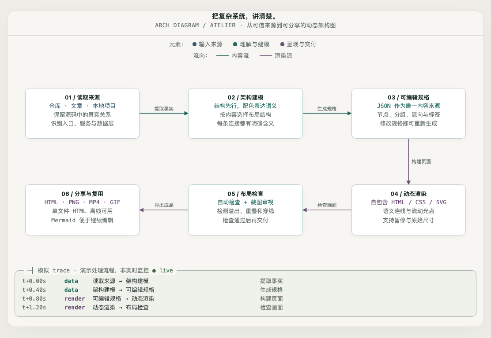

# Arch Diagram · Atelier 定制版

基于 [bassnova42/arch-diagram-skill](https://github.com/bassnova42/arch-diagram-skill) 的 MIT fork，面向月政的中文技术演示场景。保留上游作者署名及许可证。

默认采用暖白点阵画布、圆角模块、克制的语义配色与中文字体回退。新增暂停/继续动画、原始尺寸/适应窗口按钮，支持键盘操作与减少动态效果偏好；控制栏不会进入导出画面。



下载 `docs/atelier.html` 后可离线打开交互示例；`skills/arch-diagram/examples/atelier.json` 是可编辑源文件。示例是本技能自身的处理流程示意，动态 trace 表示模拟数据交换，不是真实运行监控。

## 安装定制版

```bash
git clone https://github.com/yuezheng2006/arch-diagram-skill.git
cd arch-diagram-skill
node bin/cli.mjs install
```

也可使用插件：

```bash
codex plugin marketplace add yuezheng2006/arch-diagram-skill
codex plugin add arch-diagram@arch-diagram
```

不要使用上游 npm 安装命令来获取这个定制版。此 fork 尚未发布 npm 包。安装后重启对应 Agent，在 Codex 中使用 `$arch-diagram 把当前项目画成中文动态架构图`。

## 构建与导出

```bash
node bin/cli.mjs build skills/arch-diagram/examples/atelier.json docs/atelier.html
node bin/cli.mjs check docs/atelier.html
node bin/cli.mjs export docs/atelier.html docs/atelier.png docs/atelier.mmd
```

Node ≥18；检查/截图需要 Chrome、Chromium 或 Edge；MP4/GIF 还需要 ffmpeg。HTML 完全自包含。其他命令和上游功能如下。

验证：`node tests/controls.mjs` 检查真实浏览器中的暂停/继续、窄屏尺寸切换、窗口变化与减少动态效果。所有内置示例均通过布局检查；视频循环接缝 PSNR 为 77.37 dB。

---

<p align="center">
  <b>简体中文</b> · <a href="docs/README.en.md">English</a> · <a href="docs/README.es.md">Español</a> · <a href="docs/README.ja.md">日本語</a> · <a href="docs/README.ko.md">한국어</a> · <a href="docs/README.th.md">ไทย</a>
</p>

# RokoAI arch-diagram 架构图 Skill

适用于 **Claude Code** 和 **Codex**。

给它一个 GitHub 仓库、一篇技术文章、一份 PDF 或本地项目，Claude Code 或 Codex 会读懂结构，画出一张浅色「暖纸与墨绿」风格的架构图。连线上有流动的光点，底部的 log 会在模块之间交换数据时实时加一行。

**下面是开源项目 [morluto/rea](https://github.com/morluto/rea) 的架构图，由这个 Skill 读取它的 GitHub 仓库自动生成：**


更多例子（文章、GitHub 仓库、需求文档）见文末的 [示例](#示例)。

## 能做什么

- **按内容选结构**：分层系统、流水线、带循环的流程、中心辐射、泳道、层级树，不套固定模板。
- **颜色有含义**：元素按种类上色；连线按流向类型（请求、写入、回传、异步……）区分颜色和虚实；分组框表示包含关系。
- **实时 trace log**：光点到达终点时，底部追加一行 `时间 · 类型 · A → B · 说明`。
- **自检**：用无头 Chrome 检查元素重叠、文字溢出、连线穿过方框、标签被遮挡，有问题就改到干净为止。
- **多种输出**：
  - 可交互的单文件 HTML
  - PNG（2 倍分辨率）
  - MP4：默认 20 秒，可指定任意秒数，4 秒一个周期无缝循环
  - GIF：一个周期
  - Mermaid 流程图

## 图的语言跟着提示词走

用什么语言提要求，图就是什么语言：

- 用**中文**写提示词，图里的标题、说明、标签、log 都是中文
- 用**英文**写，整张图就是英文
- 用**日语**写，内容就都是日文

即使原文或源码是另一种语言也一样。代码里的标识符、路径、命令保持原样。图例、状态标签等界面文字内置了中文、英语、日语、韩语、西班牙语、泰语；其他语言由 Claude 按你的语言写出来。

## 安装

需要 Node ≥ 18 和 Chrome、Chromium 或 Edge。输出视频和 GIF 还需要 `ffmpeg`（`brew install ffmpeg`）。

**方式一：npm**（最简单）

```bash
node bin/cli.mjs install
```

会装到 `~/.claude/skills/arch-diagram`。加 `--project` 则装到当前项目的 `.claude/skills/`。更新时再跑一次；卸载用 `node bin/cli.mjs uninstall`。

装了 Codex 的话（存在 `~/.codex`），会同时装到 `~/.codex/skills/arch-diagram`。只装其中一个，可以加 `--claude` 或 `--codex`。

**方式二：插件**。Claude Code 里依次执行：

```
/plugin marketplace add yuezheng2006/arch-diagram-skill
/plugin install arch-diagram@arch-diagram
```

Codex CLI 里：

```bash
codex plugin marketplace add yuezheng2006/arch-diagram-skill
codex plugin add arch-diagram@arch-diagram
```

**方式三：手动拷贝**

```bash
git clone https://github.com/yuezheng2006/arch-diagram-skill
cp -R arch-diagram-skill/skills/arch-diagram ~/.claude/skills/
cp -R arch-diagram-skill/skills/arch-diagram ~/.codex/skills/   # Codex
```

装好后重启 Claude Code 或 Codex。

## 用法

在 Claude Code 或 Codex 里直接说，比如：

- `把 https://github.com/plausible/analytics 画成架构图`
- `这篇文章画成流程图：<URL>，输出成视频，30 秒`
- `把刚才的图输出成图片` / `输出成 mermaid`
- 想明确指定用这个 Skill：Claude Code 里输入 `/arch-diagram <仓库或文章地址>`，Codex 里输入 `$arch-diagram <仓库或文章地址>`

图的源文件是 `<slug>.spec.json`，要修改就让 Claude Code 或 Codex 改 spec，再重新生成。也可以用命令行直接操作：

```bash
node bin/cli.mjs build  my.spec.json my.html
node bin/cli.mjs check  my.html
node bin/cli.mjs export my.html my.png my.mp4 --seconds 30
```

## 目录

```
skills/arch-diagram/
  SKILL.md            工作流程：读源 → 选结构 → 布局 → 自检 → 导出
  assets/             渲染引擎、样式、模板
  scripts/            build / check / export
  references/         spec 字段说明、视觉风格
  examples/           rea（仓库）、plausible（仓库）、elephant-goldfish（文章）
bin/cli.mjs           npm 命令：install / uninstall / build / check / export
```

## 示例

### 1. 对一篇文章做的架构图

来源：Dave Rensin 的文章《Elephants, Goldfish, and the New Golden Age of Software Engineering》  
<https://drensin.medium.com/elephants-goldfish-and-the-new-golden-age-of-software-engineering-c33641a48874>


[▶ 完整视频（MP4，30 秒）](docs/examples/elephant-goldfish.mp4)

### 2. 对一个 GitHub 仓库做的架构图

来源：<https://github.com/morluto/rea>


[▶ 完整视频（MP4，20 秒）](docs/examples/rea.mp4)

### 3. 对一份需求文档做的架构图

来源：Ballet 芭蕾动作评分小程序的需求文档（PRD）和代码。这是私有项目，没有公开链接。


[▶ 完整视频（MP4，20 秒）](docs/examples/ballet.mp4)

## License

MIT
